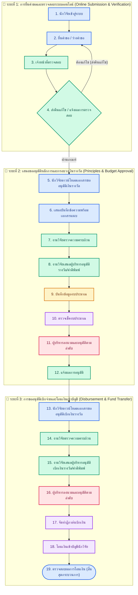

# คู่มือและกระบวนการทำงานระบบเบิกเงินรางวัลและสนับสนุนการตีพิมพ์ผลงานวิจัย (iRAM Reward System)
**คณะแพทยศาสตร์ มหาวิทยาลัยนเรศวร**  
*ปรับปรุงล่าสุด: พฤศจิกายน 2569*

---

## 📌 บทนำและวัตถุประสงค์
ระบบสารสนเทศเพื่อการบริหารจัดการรางวัลผลงานวิจัยและการตีพิมพ์ (iRAM Reward System) พัฒนาขึ้นเพื่อสนับสนุนและอำนวยความสะดวกแก่อาจารย์และนักวิจัย คณะแพทยศาสตร์ มหาวิทยาลัยนเรศวร ในการยื่นขอรับเงินรางวัลผลงานตีพิมพ์และเงินสนับสนุนค่าตีพิมพ์ (Page Charge) ตามประกาศและระเบียบคณะแพทยศาสตร์ โดยครอบคลุมกระบวนการตั้งแต่การยื่นคำขอ ตรวจสอบเอกสาร การออกบันทึกข้อความราชการ การอนุมัติงบประมาณ จนถึงการเบิกจ่ายเงินรางวัลเข้าบัญชีธนาคาร

---

## 🧭 แผนผังกระบวนการดำเนินการระบบเงินรางวัล 19 ขั้นตอน (Official 19 Workflow Steps Infographic)
*ตามโครงสร้างกระบวนการดำเนินงานระบบเงินรางวัล คณะแพทยศาสตร์ มหาวิทยาลัยนเรศวร (5 ฝ่าย 3 ระยะ 19 ขั้นตอน)*

### ตารางจำแนก 19 ขั้นตอนตามฝ่ายและระยะการดำเนินงาน

| ลำดับ | ขั้นตอนการดำเนินงาน | บทบาท / ผู้รับผิดชอบ | ระยะดำเนินงาน | คำอธิบายรายละเอียด |
|:---:|:---|:---|:---:|:---|
| **1** | นักวิจัยเข้าสู่ระบบ | นักวิจัย / เลขานุการ | ระยะที่ 1 | ผู้ขอรับเงินรางวัลเข้าสู่ระบบสารสนเทศงานวิจัยด้วยบัญชีผู้ใช้มหาวิทยาลัยนเรศวร |
| **2** | ยื่นคำขอ / ร่างคำขอ | นักวิจัย / เลขานุการ | ระยะที่ 1 | กรอกข้อมูลบทความวิจัย ระบุ DOI ตรวจสอบสิทธิ์โควตา และแนบหลักฐาน (Reprint, ใบเสร็จ) |
| **3** | เจ้าหน้าที่ตรวจสอบ | เจ้าหน้าที่งานวิจัย | ระยะที่ 1 | ตรวจสอบคุณสมบัติผลงานวิจัย ฐานข้อมูล Scopus/TCI สัดส่วนผู้ประพันธ์ และเกณฑ์เงินรางวัล |
| **4** | ส่งคืนแก้ไข / แจ้งผลการตรวจสอบ | เจ้าหน้าที่งานวิจัย | ระยะที่ 1 | หากเอกสารไม่สมบูรณ์ส่งคืนแก้ไขผ่านระบบ (Feedback Loop ย้อนไปข้อ 2) หรือแจ้งผลผ่านการตรวจ |
| **5** | นักวิจัยดาวน์โหลดเอกสารขออนุมัติเงินรางวัล | นักวิจัย / เลขานุการ | ระยะที่ 2 | ดาวน์โหลดแบบฟอร์มเอกสารขออนุมัติเงินรางวัลที่ระบบประมวลผลให้อัตโนมัติ |
| **6** | เสนอบันทึกข้อความพร้อมเอกสารแนบ | นักวิจัย / เลขานุการ | ระยะที่ 2 | ลงนามในบันทึกข้อความและรวบรวมเอกสารแนบนำส่งงานวิจัย คณะแพทยศาสตร์ |
| **7** | งานวิจัยตรวจความครบถ้วน | เจ้าหน้าที่งานวิจัย | ระยะที่ 2 | ตรวจสอบชุดเอกสารบันทึกข้อความ ลายมือชื่อ และเอกสารประกอบความถูกต้อง |
| **8** | งานวิจัยเสนอผู้บริหารอนุมัติรางวัล / ค่าตีพิมพ์ | เจ้าหน้าที่งานวิจัย | ระยะที่ 2 | จัดทำเรื่องเสนอผู้บริหาร และส่งต่อแฟ้มเรื่องไปยังงานนโยบายและแผน |
| **9** | บันทึกข้อมูลงบประมาณ | จนท. นโยบายและแผน | ระยะที่ 2 | ตรวจสอบรหัสโครงการและบันทึกตัดยอดกรอบวงเงินในระบบแผนและงบประมาณ |
| **10** | ตรวจเช็คงบประมาณ | เจ้าหน้าที่การเงิน | ระยะที่ 2 | ตรวจสอบความถูกต้องของวงเงิน แหล่งงบประมาณรายได้ และความสอดคล้องตามระเบียบการเงิน |
| **11** | ผู้บริหารลงนามและอนุมัติตามลำดับ | ผู้บริหาร | ระยะที่ 2 | หัวหน้าภาควิชา / รองคณบดีฝ่ายวิจัย / คณบดีคณะแพทยศาสตร์ ลงนามอนุมัติกรอบวงเงิน |
| **12** | แจ้งผลการอนุมัติ | เจ้าหน้าที่งานวิจัย | ระยะที่ 2 | งานวิจัยแจ้งผลการอนุมัติผ่านระบบ เพื่อให้นักวิจัยเริ่มกระบวนการขอเบิกจ่ายเงินรางวัล |
| **13** | นักวิจัยดาวน์โหลดเอกสารขออนุมัติเบิกเงินรางวัล | นักวิจัย / เลขานุการ | ระยะที่ 3 | ดาวน์โหลดแบบฟอร์มเอกสารขออนุมัติเบิกเงินรางวัล พร้อมใบสำคัญรับเงินที่ระบบออกให้ |
| **14** | งานวิจัยตรวจความครบถ้วน | เจ้าหน้าที่งานวิจัย | ระยะที่ 3 | ตรวจสอบชุดเอกสารขออนุมัติเบิกเงินรางวัลให้ตรงตามยอดและมติที่ได้รับอนุมัติ |
| **15** | งานวิจัยเสนอผู้บริหารอนุมัติเบิกเงินรางวัล / ค่าตีพิมพ์ | เจ้าหน้าที่งานวิจัย | ระยะที่ 3 | เสนอแฟ้มขออนุมัติเบิกจ่ายเงินรางวัลจริงต่อผู้บริหารฝ่ายวิจัยและคณบดี |
| **16** | ผู้บริหารลงนามและอนุมัติตามลำดับ | ผู้บริหาร | ระยะที่ 3 | ผู้บริหารลงนามอนุมัติคำสั่งเบิกจ่ายเงินรางวัลเข้าสู่กระบวนการคลัง |
| **17** | จัดทำฎีกาส่งเบิกเงิน | เจ้าหน้าที่การเงิน | ระยะที่ 3 | เจ้าหน้าที่การเงินจัดทำฎีกาเบิกเงิน (Voucher No.) และส่งเบิกต่อกองคลังมหาวิทยาลัย |
| **18** | โอนเงินเข้าบัญชีนักวิจัย | เจ้าหน้าที่การเงิน | ระยะที่ 3 | ดำเนินการโอนเงินรางวัล / ค่าตีพิมพ์เข้าบัญชีธนาคารของนักวิจัยตามที่ระบุไว้ |
| **19** | ตรวจสอบผลการโอนเงิน | นักวิจัย / เลขานุการ | ระยะที่ 3 | นักวิจัยตรวจสอบผลการโอนเงินเข้าบัญชี และระบบบันทึกสถานะการเบิกจ่ายเสร็จสมบูรณ์ |

---

### สรุปสัดส่วนภาระงานแยกตาม 5 หน่วยงาน / บทบาท
* 🎓 **นักวิจัย / เลขานุการ (6 ขั้นตอน):** ขั้นตอนที่ 1, 2, 5, 6, 13, 19
* 🔬 **เจ้าหน้าที่งานวิจัย (7 ขั้นตอน):** ขั้นตอนที่ 3, 4, 7, 8, 12, 14, 15
* 📊 **เจ้าหน้าที่นโยบายและแผน (1 ขั้นตอน):** ขั้นตอนที่ 9
* 💰 **เจ้าหน้าที่การเงิน (3 ขั้นตอน):** ขั้นตอนที่ 10, 17, 18
* 🏛️ **ผู้บริหาร (2 ขั้นตอน):** ขั้นตอนที่ 11, 16

---

## 👥 กระบวนการทำงานแบบละเอียดแยกตาม 7 กลุ่มผู้ใช้งาน

### 1. ผู้ใช้ทั่วไป (Guest / Public User)
* **การเข้าถึง:** เข้าสู่ระบบหน้าเว็บได้โดยตรงโดยไม่ต้องล็อกอิน (Public Dashboard)
* **ความสามารถและกระบวนการ:**
  1. ดูสถิติภาพรวมเงินรางวัลการตีพิมพ์รายปีงบประมาณ เช่น ยอดเงินรางวัลรวม จำนวนเรื่องที่ผ่านการอนุมัติ
  2. ติดตามสถานะคำขอด้วย **Tracking Number** (เช่น `AWP69-xxx`, `AWP70-xxx`), ชื่องานวิจัย หรือ DOI
  3. ดู Timeline ขั้นตอนการดำเนินงานของแต่ละคำขอในมุมมองสาธารณะ
  4. ได้รับการปกป้องข้อมูลส่วนบุคคลตามหลัก PDPA โดยระบบจะปกปิด (Mask) ข้อมูลสำคัญ เช่น เลขบัญชีธนาคาร (`346-X-XXXXX-7`) และเลขบัตรประชาชน
  5. มีปุ่มกดเข้าสู่ระบบผ่าน Google NU Account (`@nu.ac.th`)

---

### 2. นักวิจัย (Researcher)
* **การเข้าถึง:** ล็อกอินผ่าน Google NU Account (`@nu.ac.th`) ด้วยระบบ Single Sign-On (SSO)
* **ความสามารถและกระบวนการ:**
  1. **การยืนยันตัวตนครั้งแรก (Researcher Activation):** กดยินยอม PDPA Consent และบันทึกข้อมูลประจำตัว (เลขบัตรประชาชน 13 หลัก, ธนาคาร, เลขที่บัญชีธนาคาร 10 หลัก)
  2. **การยื่นคำขอรับรางวัล (Step 1):**
     - เลือกประเภทคำขอ: ขอรับเฉพาะเงินรางวัล / ขอเฉพาะค่าตีพิมพ์ (Page Charge) / ขอรับทั้งสองส่วน
     - ระบุ DOI หรือชื่อบทความ ระบบจะช่วยค้นหาและเติมข้อมูลวารสาร/ฐานข้อมูล Scopus ให้อัตโนมัติ
     - เลือกระดับ Quartile (Q1–Q4) และระบุสถานะ Tier 1 Top 10%
     - ระบบคำนวณเงินรางวัลให้อัตโนมัติตามประกาศ พร้อมตรวจสอบ**เพดานโควตา 150,000 บาท/คน/ปีงบประมาณ** และรอบการยกยอด (Carry Over)
     - แนบไฟล์หลักฐาน (Reprint บทความ, ใบเสร็จรับเงินค่าตีพิมพ์, หลักฐาน Affiliation)
     - เลือกกด **"บันทึกแบบร่าง (Save Draft)"** เพื่อแก้ไขภายหลัง หรือกด **"ยื่นคำขอ (Submit)"** เพื่อเข้าสู่กระบวนการ
  3. **การแก้ไขคำขอ (Step 3):** หากคำขอถูกส่งกลับ นักวิจัยสามารถเปิดแบบฟอร์มที่มีข้อมูลเดิมครบถ้วน ดูข้อความชี้แจงจากเจ้าหน้าที่ แก้ไขข้อมูล และกดส่งตรวจซ้ำได้ทันที
  4. **การดาวน์โหลดและพิมพ์เอกสาร:** สามารถพรีวิวและดาวน์โหลดชุดเอกสารราชการทางการ 5 ฉบับ ทั้งในรูปแบบ PDF และ Word (.docx)
  5. **การรับเงินรางวัลและการแจ้งเตือน (Step 12):** ได้รับการแจ้งเตือนความคืบหน้าผ่าน LINE OA ในทุกหมุดหมายสำคัญ และดาวน์โหลดสลิปโอนเงินเมื่อการเบิกจ่ายเสร็จสิ้น

---

### 3. เลขาภาควิชา (Department Secretary)
* **การเข้าถึง:** สิทธิ์เฉพาะสำหรับเลขาภาควิชาที่ได้รับมอบหมาย
* **ความสามารถและกระบวนการ:**
  1. **ยื่นคำขอแทนนักวิจัย (Delegate Submission):**
     - สามารถเลือกอาจารย์/นักวิจัยในสังกัดภาควิชาของตนเองเพื่อกรอกคำขอแทนได้
     - ระบบจะดึงข้อมูลประวัติ (เลขบัญชี, ธนาคาร, เลขบัตรประชาชน) ที่เคยบันทึกไว้มาแสดงให้อัตโนมัติ
  2. **สลับผู้ใช้เต็มรูปแบบ (Full CRUD Impersonation):**
     - สามารถกดสลับบทบาทไปเป็นนักวิจัยในภาควิชา เพื่อสร้าง แก้ไข บันทึกร่าง หรือลบคำขอแทนอาจารย์ได้เสมือนอาจารย์ดำเนินการเอง
     - สามารถกดสลับสิทธิ์กลับมาเป็นเลขาภาควิชาได้ทันที
  3. **การติดตามงานระดับภาควิชา:** ดูรายการคำขอทั้งหมดของคณาจารย์ในภาควิชาตนเอง เพื่อคอยประสานงานและอำนวยความสะดวก
  4. **การจัดการข้อมูลนักวิจัย:** เพิ่มหรือแก้ไขข้อมูลโปรไฟล์ของอาจารย์ในภาควิชาตนเอง (ตามข้อกำหนด PDPA) โดยระบบจะล็อกไม่ให้แก้ไขข้ามภาควิชาหรือไม่สามารถแก้ไขข้อมูลของ Admin ได้

---

### 4. เจ้าหน้าที่วิจัย / ผู้ประสานงาน (Research Coordinator / Staff)
* **ความสามารถและกระบวนการ (Step 2, 4, 6, 9, 12):**
  1. **ตรวจสอบความถูกต้อง (Step 2):**
     - ตรวจสอบ Checklist เอกสารแนบ, สัดส่วนผู้ประพันธ์, การระบุ Affiliation ของคณะแพทยศาสตร์ ม.นเรศวร
     - ตรวจสอบความซ้ำซ้อนของผลงานในฐานข้อมูล (DOI Deduplication)
     - ตรวจสอบยอดเงินรางวัลและค่า Page Charge ที่ขอเบิกตามประกาศคณะ
  2. **ส่งคืนแก้ไข (Return to Edit):** ส่งคำขอกลับให้นักวิจัยแก้ไขพร้อมระบุเหตุผลและคำแนะนำ
  3. **อนุมัติผลตรวจและออกเลขหนังสือ (Step 4):**
     - เมื่อตรวจสอบเอกสารครบถ้วน เจ้าหน้าที่จะกดปุ่ม **"ตรวจครบ 100%"** ซึ่งระบบจะบันทึกสถานะการอนุมัติลง D1 ทันที
     - ปลดล็อกช่องกรอกรหัสหน่วยงาน (`อว 0603.10.xx`), เลขลำดับหนังสือ และเลือกวันที่ในหนังสือผ่าน **Calendar Date Picker**
     - ระบบจะดึงข้อมูลสิ่งพิมพ์ (Vol, No, Month, Year, Pages) ที่ผู้ขอบันทึกไว้มาแสดงและจัดรูปแบบในบันทึกข้อความให้อัตโนมัติ
  4. **พิมพ์ชุดเอกสารราชการ 5 ฉบับ:**
     - ตรวจสอบเอกสารที่มีตราครุฑมาตรฐาน (ขนาด 1.5 ซม. SVG)
     - นำเสนอหัวหน้างานวิจัยและรองคณบดีฝ่ายวิจัยลงนาม (Step 5)
  5. **ส่งต่อเรื่องและส่งเอกสารตั้งฎีกา (Step 6 & Step 9):** นำชุดเอกสารส่งต่องานคลังและการเงิน
  6. **การแจ้งเตือนผ่าน LINE OA:** ส่งข้อความแจ้งเตือนสถานะคำขอไปยังนักวิจัยผ่านระบบอัตโนมัติ

---

### 5. เจ้าหน้าที่การเงิน (Finance Officer)
* **ความสามารถและกระบวนการ (Step 7, 10, 11):**
  1. **ลงรับเรื่องเบิกจ่าย (Step 7):**
     - ตรวจสอบความถูกต้องของใบสำคัญรับเงินและยอดเงินที่ขอเบิก
     - ออกเลขรับการเงิน และออกใบ **Blue Slip** เพื่อเริ่มกระบวนการคลัง
  2. **ทำฎีกาเบิกเงิน (Step 10):**
     - ส่งเรื่องเบิกจ่ายผ่านระบบการเงินของมหาวิทยาลัยนเรศวร
     - บันทึกเลขฎีกาเบิกเงิน (**Disbursement Voucher No.**) และรหัสงบประมาณค่าใช้จ่ายลงในระบบ iRAM
  3. **โอนเงินรางวัลและแนบหลักฐาน (Step 11):**
     - ดำเนินการโอนเงินเข้าบัญชีธนาคารของนักวิจัยตามที่ระบุไว้
     - อัปโหลดไฟล์หลักฐานการโอนเงิน (**Payment Transfer Slip**) เข้าระบบ
     - เปลี่ยนสถานะการจ่ายเงินเป็น **"Paid" (ชำระเงินเรียบร้อยแล้ว)**

---

### 6. ผู้บริหาร / คณบดี (Executive / Dean)
* **ความสามารถและกระบวนการ (Step 5, 8):**
  1. **หัวหน้างานวิจัย / รองคณบดีฝ่ายวิจัย (Step 5):**
     - พิจารณากลั่นกรองบันทึกข้อความขออนุมัติเงินรางวัลผลงานวิจัย
     - ลงนามรับรองความถูกต้องทางวิชาการและเสนอต่อคณบดี
  2. **คณบดีคณะแพทยศาสตร์ (Step 8):**
     - พิจารณาลงนามอนุมัติให้เบิกจ่ายเงินรางวัลจาก **"งบประมาณรายได้"** ของคณะแพทยศาสตร์
  3. **แดชบอร์ดผู้บริหาร (Executive Dashboard):**
     - ติดตามสถิติผลงานวิจัยและการใช้งบประมาณแบบภาพรวม (KPIs, Quartile Distribution, งบประมาณที่ใช้ไปเทียบกับเพดานงบประมาณ)

---

### 7. ผู้ดูแลระบบ (System Administrator)
* **ความสามารถและการจัดการระบบ:**
  1. **จัดการผู้ใช้งานและสิทธิ์ (User Management & Roles):**
     - กำหนดบทบาทผู้ใช้ (Researcher, Dept Secretary, Coordinator, Finance, Executive, Admin)
     - จัดการข้อมูลประจำตัว บัญชีธนาคาร และเลขบัตรประชาชนตามมาตรฐาน PDPA
  2. **ควบคุมปีงบประมาณและเกณฑ์เงินรางวัล:**
     - ตั้งค่าปีงบประมาณปัจจุบัน (เช่น ปี 2569, 2570)
     - จัดการระบบโควตาและการยกยอดงบประมาณ (Carry Over Quota)
  3. **ดูแลฐานข้อมูล Cloudflare D1 & Sync Console:**
     - ตรวจสอบความสมบูรณ์ของฐานข้อมูล Cloudflare D1
     - จัดการการสำรองข้อมูล (Backup) และเชื่อมโยงข้อมูลกับ Google Sheets / Apps Script
  4. **ระบบสลับผู้ใช้ขั้นสูง (Super Impersonation):**
     - สามารถสลับมุมมองไปเป็นผู้ใช้รายใดก็ได้ เพื่อช่วยตรวจสอบปัญหาหน้างานและให้คำแนะนำได้อย่างรวดเร็ว
  5. **ระบบติดตามสถิติการใช้งาน (Pageview Analytics):**
     - ดูรายงานความถี่และการเข้าใช้งานแต่ละหน้าของระบบ

---

## 📄 ชุดเอกสารราชการ 5 ฉบับที่ระบบสร้างอัตโนมัติ

1. **ฉบับที่ 1 (AWP Checklist):** รายการตรวจสอบเอกสารและข้อกำหนดการให้เงินรางวัลผลงานตีพิมพ์
2. **ฉบับที่ 2 (บันทึกขออนุมัติเงินรางวัล):** บันทึกข้อความทางการ มีตราครุฑ 1.5 ซม. เรียนคณบดีเพื่อขออนุมัติเงินรางวัล
3. **ฉบับที่ 3 (บันทึกขออนุมัติเบิกเงิน):** บันทึกข้อความฉบับเบิกเงินส่งงานคลัง อ้างอิงเลขและวันที่จากฉบับที่ 2
4. **ฉบับที่ 4 (ใบสำคัญรับเงิน):** แบบฟอร์มใบสำคัญรับเงินพร้อมแจกแจงยอดเงินรางวัลและค่าธรรมเนียม
5. **ฉบับที่ 5 (แบบคำขอและรับรอง AWP46):** แบบฟอร์มคำขอและคำรับรองการตีพิมพ์ผลงานวิจัยตามประกาศคณะฯ

---

## 🔒 มาตรฐานความปลอดภัยและการคุ้มครองข้อมูลส่วนบุคคล (PDPA Compliance)
* **การปกปิดข้อมูล (Data Masking):** ในหน้าสาธารณะและตารางรายการคำขอ ระบบจะซ่อนเลขบัญชีธนาคารและเลขบัตรประชาชนอัตโนมัติ
* **การควบคุมการเข้าถึงตามบทบาท (Role-Based Access Control - RBAC):** มีการแยกสิทธิ์อย่างเด็ดขาดตามบทบาท 7 กลุ่ม
* **การจัดเก็บข้อมูลปลอดภัย (Cloudflare D1 & Firebase):** ข้อมูลคำขอ บัญชีธนาคาร และเอกสารทางการ ถูกเข้ารหัสและจัดเก็บบน Cloudflare D1 ซึ่งเป็น Single Source of Truth
