# โครงสร้างระบบ (Site Map) และ ตารางสิทธิ์ CRUD ระบบเบิกเงินรางวัล iRAM
**หน่วยบริหารและจัดการงานวิจัย คณะแพทยศาสตร์ มหาวิทยาลัยนเรศวร**

เอกสารนี้แสดงภาพรวมสถาปัตยกรรมสารสนเทศ (Information Architecture), ผังเว็บไซต์ (Site Map), หน้าจอการทำงาน (Views/Pages), หน้าต่างป๊อปอัป (Modals), และตารางเมทริกซ์สิทธิ์การดำเนินการ **CRUD (Create, Read, Update, Delete)** ของผู้ใช้งานทั้ง 5 บทบาทหลักและผู้เยี่ยมชม

---

## 1. นิยามบทบาทผู้ใช้งาน (User Roles Definition)

| สัญลักษณ์บทบาท | รหัสในระบบ (`UserRole`) | บทบาท / ตำแหน่ง | ขอบเขตความรับผิดชอบหลัก |
| :--- | :--- | :--- | :--- |
| 🧑‍🔬 **Researcher** | `researcher` | นักวิจัย / อาจารย์ | ยื่นคำขอรับทุน, วางแผนโควตาส่วนบุคคล, แก้ไขร่างของตนเอง, ส่งคืนคำขอของตนเองเพื่อแก้ไข |
| 📋 **Coordinator** | `coordinator` | เจ้าหน้าที่วิจัย (หน่วยบริหารงานวิจัย) | ตรวจสอบเอกสาร, กำกับกระบวนการ 12 สเต็ป, ลากย้าย Kanban, ส่งต่องาน, ส่งคืนคำขอ |
| 💰 **Finance** | `finance` | เจ้าหน้าที่การเงิน (หน่วยการเงินและพัสดุ) | ตรวจสอบงบประมาณ, บันทึกเลขฎีกาเบิกจ่าย, อัปเดตสถานะการโอนเงิน, ตรวจสอบสลิป |
| 👔 **Executive** | `executive` | ผู้บริหาร / คณบดี | ดูแดชบอร์ดสรุปเชิงยุทธศาสตร์, ตรวจสอบยอดจัดสรรงบประมาณ, อนุมัติโครงการ |
| 🛡️ **Admin** | `admin` | ผู้ดูแลระบบ | ควบคุมระบบเบ็ดเสร็จ, จัดการผู้ใช้งาน, แก้ไขข้อมูลทุกมิติ, กำหนดสิทธิ์ และเชื่อมต่อ Cloudflare/Sheets |
| 🌐 **Guest** | `guest` (Unauthenticated) | ผู้เยี่ยมชมทั่วไป | ดูสถิติและตัวชี้วัดสาธารณะบนแดชบอร์ด (ไม่สามารถเข้าถึงข้อมูลส่วนบุคคลได้) |

---

## 2. ผังโครงสร้างระบบ (Site Map Architecture)

```mermaid
graph TD
    Root["🌐 ระบบเบิกเงินรางวัลผลงานวิจัย (iRAM Reward System)"]

    %% Authentication & Profiles
    Root --> Auth["🔐 ระบบเข้าสู่ระบบ & สิทธิ์การใช้งาน"]
    Auth --> LoginModal["หน้าต่างเข้าสู่ระบบ (Login / Google Sign-In)"]
    Auth --> ProfileModal["หน้าต่างข้อมูลส่วนบุคคล (User Profile)"]
    Auth --> RoleSwitch["ตัวสลับสิทธิ์การใช้งาน (Role Switcher Badge)"]

    %% Main Navigation Tabs
    Root --> MainTabs["📑 ระบบงานหลัก (Main Workspace Navigation)"]

    MainTabs --> Tab1["1. หน้าแดชบอร์ด (Dashboard View)"]
    Tab1 --> DashKPI["ตัวชี้วัด KPI สรุป 4 ด้าน"]
    Tab1 --> DashCharts["กราฟแจกแจงตาม Quartile & ภาควิชา"]
    Tab1 --> DashRecent["รายการคำขอล่าสุด & สถานะด่วน"]
    Tab1 --> NuImport["นำเข้าข้อมูลประวัติการเบิก มน. (Admin/Coordinator)"]

    MainTabs --> Tab2["2. เตรียมเบิกรางวัล & วงเงิน (Quota & Expiry Planner)"]
    Tab2 --> QuotaWidget["เครื่องจำลองเพดานเงินรางวัล (Faculty Cap: 60k / 120k / ไม่จำกัด)"]
    Tab2 --> ExpiryCalc["เครื่องคำนวณวันหมดอายุผลงาน 24 เดือน (24-Month Expiry)"]
    Tab2 --> DraftTable["ตารางรายการเตรียมเบิก (Draft Applications)"]
    DraftTable --> FormModalNew["ยื่นคำขอใหม่ / บันทึกร่าง"]
    DraftTable --> BatchSubmit["ส่งเบิกคำขอแบบเดี่ยว / แบบกลุ่ม (Batch Submit)"]
    DraftTable --> CarryOver["เลื่อนปีงบประมาณเตรียมเบิก (Carry Over)"]

    MainTabs --> Tab3["3. ตารางบทความรวม มน. & คณะ (Article Master Table)"]
    Tab3 --> Category1["หมวด 1: ยื่นคำขอเบิกแล้ว (Submitted/In Process)"]
    Tab3 --> Category2["หมวด 2: รายการเตรียมเบิก (Preparing / Drafts)"]
    Tab3 --> Category3["หมวด 3: ประวัติการเบิกจ่าย มน. ย้อนหลัง (Historical DRI NU)"]
    Tab3 --> ArtDetail["หน้าต่างดูรายละเอียดบทความ (Article Detail Modal)"]
    Tab3 --> ArtEdit["หน้าต่างแก้ไขข้อมูล มน. & คณะ (Admin Edit Modal)"]
    Tab3 --> ExportExcelMaster["ส่งออก Excel ตารางบทความรวม"]

    MainTabs --> Tab4["4. ติดตามแบบลากวาง (Kanban Board)"]
    Tab4 --> Lane1["เลน 1: ยื่นคำขอใหม่ (ขั้นตอน 1 - 2)"]
    Tab4 --> Lane2["เลน 2: ตรวจสอบ & ลงนาม (ขั้นตอน 3 - 4)"]
    Tab4 --> Lane3["เลน 3: เสนอผู้บริหาร & คณบดี (ขั้นตอน 5 - 8)"]
    Tab4 --> Lane4["เลน 4: การเงินจัดทำฎีกา (ขั้นตอน 9 - 10)"]
    Tab4 --> Lane5["เลน 5: โอนเงินเรียบร้อย & ปิดงาน (ขั้นตอน 11 - 12)"]

    MainTabs --> Tab5["5. ตารางข้อมูลคำขอหลัก (Table View)"]
    Tab5 --> ColView["ตาราง 10 คอลัมน์ (รหัสคำขอ, ผู้ยื่น, บทความ, รางวัล, ฎีกา, จัดการ)"]
    Tab5 --> InlineEdit["ระบบแก้ไขข้อมูลในตาราง (Inline Grid Edit)"]
    Tab5 --> ReturnAction["ปุ่มส่งคืนไปรายการเตรียมเบิกเพื่อแก้ไข (Return to Draft)"]
    Tab5 --> MaskPDPA["ระบบซ่อน/แสดงข้อมูลส่วนบุคคล PDPA"]
    Tab5 --> ExportExcelMain["ส่งออก Excel ตารางคำขอหลัก"]

    MainTabs --> Tab6["6. ปฏิทินรอบเบิกจ่าย (Calendar View)"]
    Tab6 --> CalEvents["รอบประชุมกรรมการ, รอบตัดยอด, รอบเงินโอน, วันสิ้นสุด SLA"]
    Tab6 --> GCalSync["เชื่อมโยงเปิดใน Google Calendar"]

    MainTabs --> Tab7["7. ศูนย์แจ้งเตือน LINE OA (Line Notification Console)"]
    Tab7 --> LineTriggers["ทริกเกอร์แจ้งเตือนอัตโนมัติ 4 เหตุการณ์"]
    Tab7 --> LineManual["ส่งข้อความแจ้งเตือนรายบุคคล / บันทึกประวัติ"]

    MainTabs --> Tab8["8. จัดการผู้ใช้งาน (User Management Console)"]
    Tab8 --> UserList["รายชื่อผู้ใช้, ตำแหน่ง, ภาควิชา, เลขบัญชี, Scopus ID"]
    Tab8 --> UserRoleAssign["กำหนดสิทธิ์ Role & ระงับการใช้งาน"]
    Tab8 --> UserSwitch["จำลองการเข้าใช้งาน (Switch User Emulation)"]

    %% Action Modals Connected
    Root --> ActionModals["🪟 หน้าต่างโต้ตอบและพิมพ์เอกสาร (Interactive Modals)"]
    ActionModals --> SubmissionModal["แบบฟอร์มขอรับทุน / แก้ไขคำขอเดิม (Submission Form Modal)"]
    ActionModals --> TimelineModal["ไทม์ไลน์ติดตาม 12 ขั้นตอน (Timeline SLA Tracker Modal)"]
    ActionModals --> PrintModal["พิมพ์เอกสารราชการ AWP69 / บันทึกข้อความ (Official Print Modal)"]
    ActionModals --> PaymentModal["ตรวจสอบหลักฐานการโอนเงิน / สลิป (Payment Verification Modal)"]
    ActionModals --> SheetsModal["ตั้งค่าเชื่อมต่อ Google Sheets API"]
```

---

## 3. ตารางแสดงหน้าเพจและองค์ประกอบทั้งระบบ (System Pages & Components Inventory)

| รหัสโมดูล | ชื่อหน้าจอ / โมดูล | ชนิดองค์ประกอบ | URL / แท็บอ้างอิง | ผู้มีสิทธิ์เข้าถึง (Access Rights) | วัตถุประสงค์หลัก |
| :--- | :--- | :--- | :--- | :--- | :--- |
| **P-01** | แดชบอร์ดสรุปสถานะ | Main View Tab | `activeTab = 'dashboard'` | ทุกบทบาท (Researcher, Coordinator, Finance, Executive, Admin, Guest) | สรุป KPI, ยอดรวมเงินรางวัล, สถิติ Quartile, กราฟแจกแจงตามภาควิชา |
| **P-02** | เตรียมเบิกรางวัล & วงเงิน | Main View Tab | `activeTab = 'quota_planner'` | Researcher, Coordinator, Admin | ตรวจสอบเพดานเงินรางวัล, เช็คสิทธิ์ 24 เดือน, จัดการคำขอเตรียมเบิก (ร่าง) |
| **P-03** | ตารางบทความรวม (มน. & คณะ) | Main View Tab | `activeTab = 'article_table'` | ทุกบทบาท (ยกเว้น Guest) | รวมบทความ 3 หมวด ติดตามสถานะเบิกจ่ายคู่ขนาน มน. และ คณะฯ |
| **P-04** | ติดตามแบบลากวาง (Kanban) | Main View Tab | `activeTab = 'kanban'` | Coordinator, Admin | กระดานลากวาง 5 เลน ควบคุมความก้าวหน้า 12 สเต็ป |
| **P-05** | ตารางข้อมูลคำขอหลัก (Grid) | Main View Tab | `activeTab = 'table'` | ทุกบทบาท (ยกเว้น Guest) | ตารางฐานข้อมูลคำขอ, แก้ไขข้อมูลในตาราง (Inline Edit), ส่งคืนคำขอ |
| **P-06** | ปฏิทินรอบเบิกจ่าย | Main View Tab | `activeTab = 'calendar'` | ทุกบทบาท (ยกเว้น Guest) | ปฏิทินรอบประชุม, รอบตัดยอด, รอบเงินโอน, วันสิ้นสุด SLA |
| **P-07** | ศูนย์แจ้งเตือน LINE OA | Main View Tab | `activeTab = 'line_oa'` | Coordinator, Admin *(เมื่อเปิดระบบ)* | ควบคุมการส่งแจ้งเตือนผ่าน LINE Official Account (@414jvrca) |
| **P-08** | จัดการผู้ใช้งาน (Admin Console) | Main View Tab | `activeTab = 'user_management'` | Admin เท่านั้น | บริหารบัญชีผู้ใช้, กำหนดสิทธิ์ Role, ปรับสถานะ, จำลองการล็อกอิน |
| **M-01** | แบบฟอร์มขอรับทุน / แก้ไขคำขอ | Modal Dialog | `SubmissionFormModal` | Researcher, Coordinator, Admin | ยื่นคำขอใหม่, บันทึกฉบับร่าง, แก้ไขคำขอเดิมที่ส่งคืนมา |
| **M-02** | ไทม์ไลน์ติดตาม 12 ขั้นตอน | Modal Dialog | `TimelineTrackerModal` | ทุกบทบาท (สิทธิ์กดเลื่อนขั้นตามความรับผิดชอบ) | ตรวจสอบ SLA แต่ละสเต็ป, บันทึกข้อความ, ส่งต่องาน, ส่งคืนคำขอ |
| **M-03** | พิมพ์เอกสารราชการ | Modal Dialog | `OfficialPrintModal` | ทุกบทบาท (ยกเว้น Guest) | พิมพ์แบบฟอร์ม กวพ. (AWP69), บันทึกข้อความ, สลิป/ใบสำคัญรับเงิน |
| **M-04** | ตรวจสอบการโอนเงิน & สลิป | Modal Dialog | `PaymentVerificationModal` | ทุกบทบาท (ยกเว้น Guest) | ดูข้อมูลเลขที่ฎีกา, วันที่โอนเงิน, พิมพ์หลักฐานการจ่ายเงิน |
| **M-05** | แก้ไขข้อมูลบทความรวม มน./คณะ | Modal Dialog | `ArticleMasterEditModal` | Admin เท่านั้น | ปรับปรุงสถานะ มน. และ คณะฯ, แก้ไขยอดเงินรางวัล, บันทึกเลขฎีกา มน. |
| **M-06** | ข้อมูลส่วนตัวผู้ใช้ | Modal Dialog | `UserProfileModal` | เจ้าของบัญชีผู้ใช้ทุกท่าน | ดูและแก้ไขข้อมูลส่วนตัว, เลขที่บัญชีธนาคาร, เบอร์โทรศัพท์, ตำแหน่ง |
| **M-07** | เข้าสู่ระบบ / สลับบัญชี | Modal Dialog | `LoginModal` | ทุกท่าน (รวมทั้ง Guest) | เข้าสู่ระบบด้วย Google Account หรือเลือกบัญชีผู้ใช้สำหรับทดสอบ |
| **M-08** | ตั้งค่าเชื่อมต่อ Google Sheets | Modal Dialog | `GoogleSheetsSettingsModal` | Coordinator, Admin | จัดการ Spreadsheet ID และโทเค็นการเชื่อมต่อ Google Sheets |

---

## 4. ตารางวิเคราะห์สิทธิ์ CRUD แยกตามหน้าเพจและบทบาทผู้ใช้งาน (CRUD Permission Matrix)

> **คำอธิบายสัญลักษณ์สิทธิ์:**
> - **C (Create):** สร้างใหม่ / ยื่นคำขอ / เพิ่มรายการ
> - **R (Read):** ดูข้อมูล / อ่านรายละเอียด (`R-Own` = ดูเฉพาะของตนเอง, `R-All` = ดูทุกคนในคณะ, `R-Pub` = ดูสถิติรวมสาธารณะ)
> - **U (Update):** แก้ไขข้อมูล / อัปเดตสถานะ (`U-Own` = แก้ไขเฉพาะของตนเอง, `U-Role` = แก้ไขเฉพาะฟิลด์ตามบทบาท, `U-All` = แก้ไขได้ทุกฟิลด์)
> - **D (Delete):** ลบข้อมูล / ยกเลิกรายการ (`D-Own` = ลบเฉพาะของตนเอง, `D-All` = ลบได้ทั้งหมด)
> - **Return (↩️):** ส่งคืนคำขอกลับไปยังรายการเตรียมเบิกเพื่อแก้ไข (`Ret-Own` = ส่งคืนเฉพาะของตนเอง, `Ret-All` = ส่งคืนของทุกคน)
> - **Advance (⏭️):** กดยืนยันผ่านขั้นตอนในไทม์ไลน์ 12 สเต็ป (`Adv-Role` = เลื่อนขั้นเฉพาะขั้นตอนที่ตนเองรับผิดชอบ, `Adv-All` = เลื่อนได้ทุกขั้นตอน)
> - **- (None):** ไม่มีสิทธิ์เข้าถึงหรือดำเนินการ

### ตารางที่ 1: เมนูและหน้าจอหลัก (Main Views / Tabs)

| หน้าจอ / โมดูล | ฟังก์ชัน / Resource | Researcher 🧑‍🔬 | Coordinator 📋 | Finance 💰 | Executive 👔 | Admin 🛡️ | Guest 🌐 |
| :--- | :--- | :---: | :---: | :---: | :---: | :---: | :---: |
| **P-01: Dashboard** | ดูสถิติ KPI สรุป | **R-Own** | **R-All** | **R-All** | **R-All** | **R-All** | **R-Pub** |
| | นำเข้าประวัติเบิกจ่าย มน. | - | **C / U** | - | - | **C / U / D** | - |
| | ยื่นคำขอด่วนจากแดชบอร์ด | **C** | **C** | - | - | **C** | - |
| **P-02: Quota Planner** | ใช้งานเครื่องคำนวณ 24 เดือน | **R / U** | **R / U** | - | - | **R / U** | - |
| | ดูรายการเตรียมเบิก (Draft) | **R-Own** | **R-All** | - | - | **R-All** | - |
| | สร้างรายการเตรียมเบิกใหม่ | **C** | **C** | - | - | **C** | - |
| | แก้ไขรายการเตรียมเบิก | **U-Own** | **U-All** | - | - | **U-All** | - |
| | ลบรายการเตรียมเบิก | **D-Own** | **D-All** | - | - | **D-All** | - |
| | ส่งเบิกคำขอ (Submit Draft) | **U-Own** | **U-All** | - | - | **U-All** | - |
| | เลื่อนปีงบประมาณ (Carry Over) | **U-Own** | **U-All** | - | - | **U-All** | - |
| **P-03: Article Master** | ดูตารางบทความรวม 3 หมวด | **R-Own** | **R-All** | **R-All** | **R-All** | **R-All** | - |
| | ตัวกรองบทความของฉัน vs ทั้งหมด | **R-Own** | **R-Toggle** | **R-Toggle** | **R-Toggle** | **R-Toggle** | - |
| | ส่งออกข้อมูลเป็น Excel | **R-Own** | **R-All** | **R-All** | **R-All** | **R-All** | - |
| | แก้ไขสถานะ มน. และ คณะฯ | - | - | - | - | **U-All** | - |
| | เพิ่มรายการประวัติเบิก มน. | - | **C** | - | - | **C** | - |
| **P-04: Kanban Board** | เข้าถึงหน้ากระดาน Kanban | - | **R-All** | - | - | **R-All** | - |
| | ลากย้ายสถานะการ์ด (Drag & Drop) | - | **U-Role** (สเต็ป 1-8) | - | - | **U-All** (สเต็ป 1-12) | - |
| | ส่งคืนคำขอบนการ์ดไปเตรียมเบิก | - | **Ret-All** | - | - | **Ret-All** | - |
| **P-05: Table View** | ดูตารางคำขอหลัก | **R-Own** | **R-All** | **R-All** | **R-All** | **R-All** | - |
| | แก้ไขในตาราง (Inline Edit) | - | **U-Role** (ข้อมูลวิจัย/เลขรับ) | **U-Role** (เลขฎีกา/วันโอน) | - | **U-All** (ทุกคอลัมน์) | - |
| | ส่งคืนคำขอย้อนกลับไปเตรียมเบิก | **Ret-Own** | **Ret-All** | - | - | **Ret-All** | - |
| | ซ่อน/เปิดเผยข้อมูลบัตร ปชช./บัญชี | **U-Mask** | **U-Mask** | **U-Mask** | **U-Mask** | **U-Mask** | - |
| | ส่งออก Excel ตารางคำขอ | **R-Own** | **R-All** | **R-All** | **R-All** | **R-All** | - |
| **P-06: Calendar View** | ดูรอบเงินโอนและกำหนดการ | **R-Own** | **R-All** | **R-All** | **R-All** | **R-All** | - |
| | เปิดดูใน Google Calendar | **R** | **R** | **R** | **R** | **R** | - |
| **P-07: LINE OA** | ส่งแจ้งเตือนรายบุคคล / กลุ่ม | - | **C / U** | - | - | **C / U** | - |
| | ดูประวัติ Log การส่งข้อความ | - | **R** | - | - | **R** | - |
| **P-08: User Management**| เข้าสู่หน้าคอนโซลผู้ใช้ | - | - | - | - | **R-All** | - |
| | สร้างบัญชีผู้ใช้ใหม่ | - | - | - | - | **C** | - |
| | แก้ไขข้อมูลและสิทธิ์ผู้ใช้ (Roles) | - | - | - | - | **U-All** | - |
| | ระงับ / เปิดการใช้งานบัญชี | - | - | - | - | **U-All** | - |
| | ลบบัญชีผู้ใช้งาน | - | - | - | - | **D-All** | - |
| | สลับผู้ใช้ (Switch User Emulation) | - | - | - | - | **U-Auth** | - |

---

### ตารางที่ 2: หน้าต่างโต้ตอบและโมดัล (Interactive Modals)

| หน้าต่างป๊อปอัป (Modal) | ฟังก์ชัน / Resource | Researcher 🧑‍🔬 | Coordinator 📋 | Finance 💰 | Executive 👔 | Admin 🛡️ | Guest 🌐 |
| :--- | :--- | :---: | :---: | :---: | :---: | :---: | :---: |
| **M-01: Submission Form** | กรอกข้อมูลคำขอใหม่ | **C** | **C** | - | - | **C** | - |
| | คำนวณเงินรางวัล/เพจชาร์จตามเกณฑ์ | **R** | **R** | - | - | **R** | - |
| | บันทึกฉบับร่าง (Save Draft) | **C / U-Own** | **C / U-All** | - | - | **C / U-All** | - |
| | ยื่นคำขอรับทุน (Submit) | **C / U-Own** | **C / U-All** | - | - | **C / U-All** | - |
| | แก้ไขคำขอเดิม (คงเลข AWP เดิม) | **U-Own** | **U-All** | - | - | **U-All** | - |
| **M-02: Timeline Tracker** | ดูไทม์ไลน์ SLA 12 สเต็ป | **R-Own** | **R-All** | **R-All** | **R-All** | **R-All** | - |
| | บันทึกข้อความในขั้นตอน | **U-Role** (สเต็ป 1, 3) | **U-Role** (สเต็ป 2, 4, 6, 9) | **U-Role** (สเต็ป 5, 10, 11) | **U-Role** (สเต็ป 7, 8) | **U-All** (ทุกสเต็ป) | - |
| | กดยืนยันผ่านขั้นตอน (Advance) | **Adv-Role** (1, 3) | **Adv-Role** (2, 4, 6, 9) | **Adv-Role** (5, 10, 11) | **Adv-Role** (7, 8) | **Adv-All** (1-12) | - |
| | ส่งคืนไปรายการเตรียมเบิก (`↩️`) | **Ret-Own** | **Ret-All** | - | - | **Ret-All** | - |
| **M-03: Official Print** | ดูตัวอย่างและพิมพ์เอกสาร | **R-Own** | **R-All** | **R-All** | **R-All** | **R-All** | - |
| | ปรับแก้เลขสารบรรณ/เลขรับเรื่อง | - | **U-All** | - | - | **U-All** | - |
| **M-04: Payment Modal** | ดูข้อมูลเลขที่ฎีกาและวันโอนเงิน | **R-Own** | **R-All** | **R-All** | **R-All** | **R-All** | - |
| | พิมพ์สลิปและใบสำคัญรับเงิน | **R-Own** | **R-All** | **R-All** | **R-All** | **R-All** | - |
| **M-05: Article Master Edit**| แก้ไขสถานะ/ยอดเงินรางวัล มน. | - | - | - | - | **U-All** | - |
| | แก้ไขสถานะ/เลขฎีกา คณะฯ | - | - | - | - | **U-All** | - |
| | ปุ่มคลิกด่วน "จ่ายแล้วทั้งสองฝั่ง"| - | - | - | - | **U-All** | - |
| **M-06: User Profile** | ดูข้อมูลโปรไฟล์ตนเอง | **R-Own** | **R-Own** | **R-Own** | **R-Own** | **R-Own** | - |
| | แก้ไขข้อมูลการติดต่อ/เลขที่บัญชี | **U-Own** | **U-Own** | **U-Own** | **U-Own** | **U-Own** | - |
| **M-07: Login / Switch** | เข้าสู่ระบบด้วย Google / อีเมล | **R / U** | **R / U** | **R / U** | **R / U** | **R / U** | **R / U** |
| **M-08: Sheets Settings** | บันทึก Spreadsheet ID / Token | - | **U** | - | - | **U** | - |
| | ซิงก์ประวัติเบิกจ่าย มน. ทันที | - | **C / U** | - | - | **C / U** | - |

---

## 5. ตารางสรุปการแบ่งหน้าที่ในกระบวนการ 12 ขั้นตอน (12-Step SLA Workflow Responsibility)

| สเต็ป | ชื่อขั้นตอนตามระเบียบราชการ | ผู้รับผิดชอบหลักตามระเบียบ | บทบาทในระบบที่มีสิทธิ์กดยืนยัน (Advance Step) | หมายเหตุ / กฎทางธุรกิจ |
| :---: | :--- | :--- | :--- | :--- |
| **1** | ยื่นแบบฟอร์มขอรับทุนผ่านระบบออนไลน์ | นักวิจัยผู้ขอรับทุน | `researcher`, `coordinator`, `admin` | นักวิจัยยื่นเอง หรือเจ้าหน้าที่ช่วยยื่น |
| **2** | เจ้าหน้าที่งานวิจัยตรวจสอบเอกสารและเกณฑ์ | เจ้าหน้าที่วิจัย | `coordinator`, `admin` | ตรวจเกณฑ์ 24 เดือน, ควอไทล์, เพดานเงินรางวัล |
| **3** | ผู้วิจัยลงนามและแนบเอกสารฉบับจริง/อีเมลยืนยัน | นักวิจัยผู้ขอรับทุน | `researcher`, `coordinator`, `admin` | ยืนยันเอกสารลงนาม |
| **4** | เจ้าหน้าที่งานวิจัยลงรับเรื่องและบันทึกเลขระบบ | เจ้าหน้าที่วิจัย | `coordinator`, `admin` | บันทึกเลขทะเบียนรับงานวิจัย |
| **5** | หน่วยการเงินและพัสดุตรวจสอบงบประมาณ | เจ้าหน้าที่การเงิน | `finance`, `admin` | ตรวจสอบยอดคงเหลือของหมวดเงินรางวัล |
| **6** | เสนอหัวหน้างาน/ผู้ช่วยคณบดีพิจารณากลั่นกรอง | เจ้าหน้าที่วิจัย | `coordinator`, `admin` | สรุปความเห็นเสนอผู้บริหาร |
| **7** | รองคณบดีฝ่ายวิจัยพิจารณาให้ความเห็นชอบ | ผู้บริหารงานวิจัย | `executive`, `admin` | ให้ความเห็นชอบเสนอคณบดี |
| **8** | คณบดีคณะแพทยศาสตร์ลงนามอนุมัติ | คณบดี | `executive`, `admin` | ลงนามคำสั่งอนุมัติเบิกจ่าย |
| **9** | เจ้าหน้าที่งานวิจัยแจ้งผลอนุมัติและส่งเอกสารการเงิน | เจ้าหน้าที่วิจัย | `coordinator`, `admin` | ออกเลขที่คำสั่ง/แจ้งนักวิจัยผ่านระบบ |
| **10** | หน่วยการเงินและพัสดุจัดทำฎีกาเบิกจ่ายเงิน | เจ้าหน้าที่การเงิน | `finance`, `admin` | บันทึกเลขที่ฎีกา (เช่น ฎีกา 3606/70) |
| **11** | โอนเงินเข้าบัญชีธนาคารกรุงศรีของผู้วิจัย | เจ้าหน้าที่การเงิน | `finance`, `admin` | บันทึกวันที่โอนเงินและหลักฐานสลิป |
| **12** | ปิดงานและแจ้งยอดผ่านระบบสำเร็จ | เจ้าหน้าที่วิจัย / การเงิน | `coordinator`, `finance`, `admin` | สิ้นสุดกระบวนการ (Completed) |

---

## 6. สรุปจุดเด่นของระบบควบคุมสิทธิ์ใน iRAM (Security & Governance Highlights)

1. **Principle of Least Privilege (สิทธิ์ขั้นต่ำตามบทบาท):**
   - นักวิจัยเข้าถึงได้เฉพาะข้อมูลคำขอและบทความของตนเอง
   - ผู้บริหารสามารถตรวจสอบภาพรวม สถิติ และอนุมัติได้ แต่ไม่สามารถแก้ไขข้อมูลบัญชีหรือเลขฎีกาการเงินโดยพลการ
   - เจ้าหน้าที่การเงินแก้ไขได้เฉพาะข้อมูลเกี่ยวกับการเงินและเลขที่ฎีกา
2. **Preservation of Tracking Number (คงรหัสคำขอเดิมเมื่อส่งคืน):**
   - คำขอที่ถูกส่งคืนเพื่อแก้ไขจะไม่สูญเสียรหัสติดตามงานเดิม (เช่น `AWP69-054`) เมื่อแก้ไขและส่งเบิกใหม่จะบันทึกทับรหัสเดิม ไม่เกิดเลขขยะในฐานข้อมูล
3. **Multi-Role Support (ผู้ใช้งานหนึ่งท่านสามารถมีหลายบทบาท):**
   - ระบบรองรับผู้ใช้งานที่เป็นทั้งอาจารย์แพทย์ (นักวิจัย) และดำรงตำแหน่งบริหาร (ผู้บริหาร) หรือปฏิบัติหน้าที่เจ้าหน้าที่วิจัย โดยสามารถสลับบทบาทได้อย่างราบรื่นผ่าน **Role Switcher**
4. **Cloudflare D1 & Offline Resiliency:**
   - ทุกการเปลี่ยนแปลง CRUD จะถูกบันทึกลง Local Cache ทันที และซิงก์แบบอะซิงโครนัสขึ้น Cloudflare D1 หากเครือข่ายขัดข้อง ระบบจะเตือนและทำงานต่อได้อย่างต่อเนื่อง
